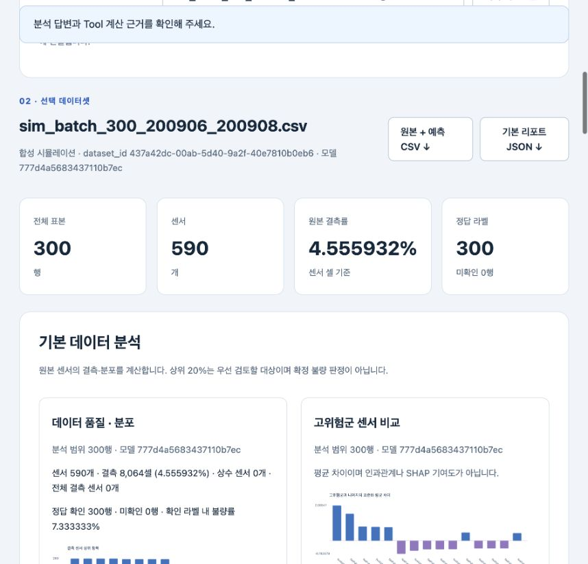
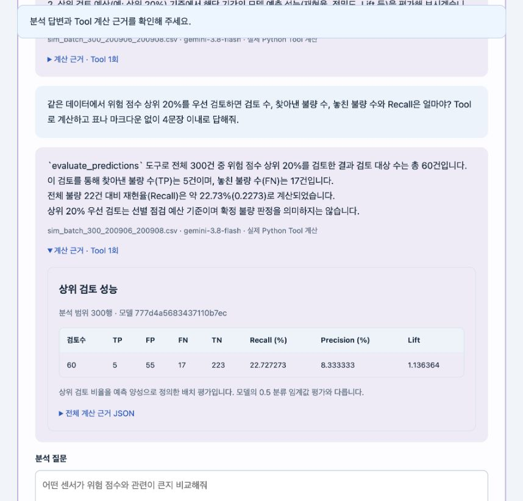
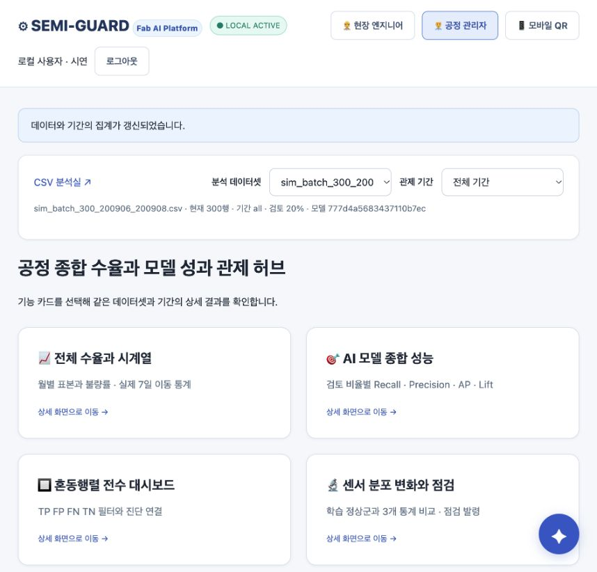
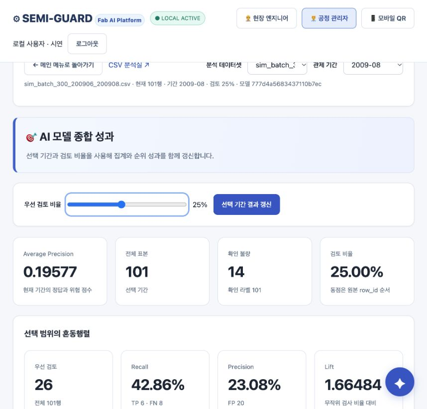
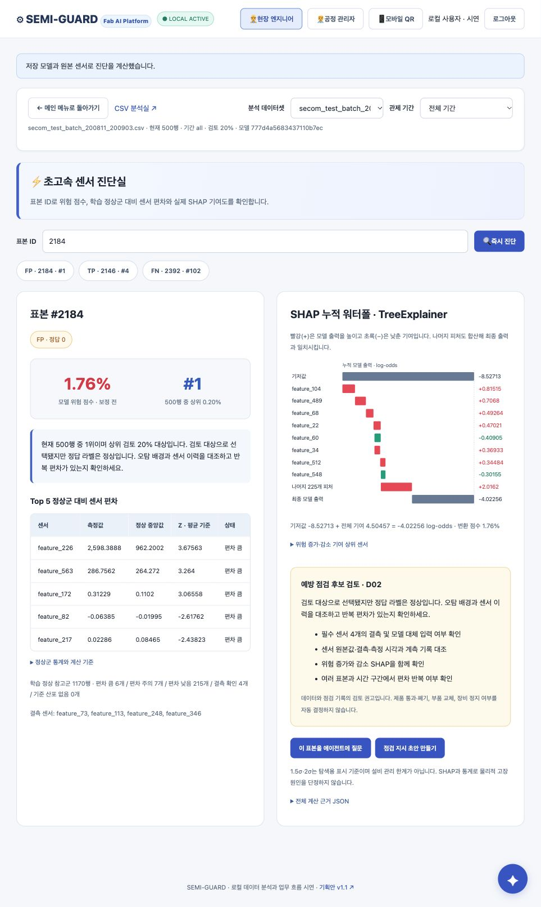

# 🛡️ SEMI-GUARD v3.0
### 반도체 공정(SECOM) 불량 조기 탐지 & AI 통합 관제·데이터 분석 시스템

[](https://www.python.org/)
[](https://fastapi.tiangolo.com/)
[](https://lightgbm.readthedocs.io/)
[](https://github.com/slundberg/shap)
[](https://ai.google.dev/)
[](tests/)

---

## 📌 프로젝트 소개 (Overview)

**SEMI-GUARD v3.0**은 반도체 웨이퍼 제조 공정의 590개 센서 데이터(SECOM)를 바탕으로 **불량 웨이퍼를 조기에 탐지**하고, **XAI(SHAP)와 LLM 에이전트를 결합하여 이상 원인을 과학적으로 진단·관제**하는 엔터프라이즈 AI 시스템입니다.

기존의 정적 대시보드나 환각(Hallucination) 위험이 있는 일반 LLM 챗봇을 탈피하여, **엄격한 데이터 무결성 계약**과 **12종의 검증된 Python 분석 도구(Tools)**를 기반으로 동작하는 **Gemini 3.8 Flash 분석 에이전트**를 탑재했습니다.

```
[CSV 센서 데이터 업로드] ──▶ [저장된 모델 추론 (LightGBM)] ──▶ [원본+예측 DB 영속 저장]
                                                                        │
        ┌───────────────────────────────────────────────────────────────┴───────────────────────────────┐
        ▼                                                                                               ▼
┌──────────────────────────────────────────────┐                ┌──────────────────────────────────────────────┐
│          🧪 CSV 분석실 (EDA Lab)             │                │        🎛️ 공정 관제 대시보드 (Control)       │
│  - 590개 센서 자동 품질/결측 진단            │                │  - 기간별·월별 불량률 및 7일 이동평균 추이   │
│  - 표본별 SHAP 워터폴 & Top 5 센서 정밀진단  │                │  - Top-K% 검토 성능 평가 & Confusion Matrix  │
│  - Gemini 에이전트 Tool 기반 자연어 질의응답 │                │  - 엔지니어 수동 점검 발령 및 승인 결재 체계 │
└──────────────────────────────────────────────┘                └──────────────────────────────────────────────┘
```

> [!NOTE]
> **핵심 원칙 (AGENTS.md 준수)**: 신규 CSV 데이터에 대해 모델을 재학습(fit)하지 않으며, 사전에 검증된 저장 전처리(transform)와 저장 모델(LightGBM)로만 추론합니다. 오류나 미확인 라벨, SHAP 값을 임의의 가짜 데모 값으로 대체하지 않고 정확한 계산 근거만을 제공합니다.

---

## 🖼️ 시스템 화면 미리보기 (Showcase)

SEMI-GUARD는 **데이터 과학자를 위한 정밀 탐색 분석실**과 **공정 엔지니어/관리자를 위한 실시간 관제 대시보드** 두 가지 인터페이스를 제공합니다.

### 1. CSV 분석실: 자동 기본 분석 (EDA)
> CSV를 업로드하거나 시뮬레이션 배치를 선택하면 즉시 590개 센서의 결측률, 라벨 불량률, 위험도 분포를 자동 산출합니다.



---

### 2. Gemini 3.8 Flash 기반 데이터 분석 에이전트
> 자연어로 질문하면 LLM이 필요한 Python 분석 Tool을 직접 호출(Function Calling)하고, **실제 계산된 수치 근거(JSON)를 바탕으로 신뢰성 있는 답변**을 생성합니다.



---

### 3. 통합 공정 관제 대시보드 (Control Center Hub)
> 기간별 수율 및 불량률 추이, 7일 이동평균, 위험 웨이퍼 목록, 공정 점검 지시 및 승인 워크플로우를 한곳에서 관리합니다.



---

### 4. 검토 비율(Top-K%)별 모델 성능 & 혼동행렬 탐색
> 한정된 검사 자원 환경에서 검토 비율(5%~50%)에 따른 Recall, Precision, Lift 변화를 분석하고 전체 표본의 TP/FP/FN/TN을 즉시 조회합니다.



---

### 5. 웨이퍼 표본 정밀진단 & SHAP Waterfall 설명
> 개별 웨이퍼(Sample ID)의 Top 5 이상 센서 상태(정상 5~95% 구간 대비 이탈 여부)와 누적 SHAP 기여도 워터폴 차트를 통해 오탐(FP)과 진성불량(TP)을 명확히 판별합니다.



---

## 🏗️ 시스템 아키텍처 & 워크플로우

### 1. 서비스 아키텍처 (Service Architecture)
SEMI-GUARD의 전체 계층 구조와 Gemini AI Agent의 Tool 호출 루프를 나타냅니다.


- **UI 계층**: HTML/Vanilla JS 기반의 고반응성 경량 웹 인터페이스 (CSV 분석실 `/`, 공정 관제 `/dashboard/`).
- **API 계층**: FastAPI 기반 REST 엔드포인트 및 브라우저 세션 쿠키 기반 데이터셋 격리.
- **분석 에이전트 계층**: Gemini 3.8 Flash의 Function Calling을 활용한 최대 6회 반복 Tool 호출 루프.
- **데이터 & 모델 계층**: LightGBM 저장 모델 추론, SHAP TreeExplainer, SQLite/GCS 영속 저장소.

---

### 2. 데이터 파이프라인 워크플로우 (Data Pipeline)
데이터 업로드부터 검증, 전처리, 추론, DB 보관에 이르는 전 과정입니다.


1. **입력 검증 (`validation.py`)**: 590개 센서 포맷, 모델 필수 232개 피처 유무, 비수치/무한대 값, 중복 헤더 검증.
2. **저장된 전처리 변환 (`inference.py`)**: 학습 시 저장된 중앙값 대치(Imputer) 적용 (재학습 엄격 금지).
3. **추론 및 XAI**: LightGBM 불량 확률 예측 및 TreeExplainer 기반 SHAP Value 계산.
4. **영속 저장 (`repository.py`)**: 원본 센서값과 예측 결과를 불변 고유 식별자(`row_id`)로 결합하여 SQLite/GCS에 단일 트랜잭션으로 저장.

---

## 🛠️ 12종 Python 데이터 분석 도구 (Analysis Tools)

Gemini 에이전트는 환각 없이 아래 12개 등록 도구를 호출하여 수치적 근거를 산출합니다. 사용자는 UI에서 도구를 직접 수동 실행할 수도 있습니다.

| 도구명 (Tool) | 분석 내용 및 역할 | 주요 파라미터 / 입력 조건 |
|---|---|---|
| `profile_dataset` | 데이터셋 행/센서 수, 결측치·상수열 현황, 라벨 및 예측 위험도 분포 요약 | 데이터셋 전체 센서값 |
| `rank_samples` | 예측 위험 점수 상위/하위 N개 표본과 원본 센서값 조회 | `top_n`, `ascending` |
| `query_data` | 조건 필터링, 컬럼 선택, 정렬, 그룹 집계 (자유 질의) | `filters`, `columns`, `sort_by` |
| `compare_groups` | 고위험군(상위 20%)과 정상군의 센서 평균 및 표준화 차이(Z-Score) 비교 | `threshold_ratio` |
| `correlate` | 센서와 위험 점수 간 상관계수 또는 센서 간 상관계수 산출 | `target_col`, `top_n` |
| `time_summary` | 일별/주별/월별 표본 수, 평균 위험 점수, 확인 라벨 불량률 추이 | `freq` ('M', 'W', 'D'), timestamp 필요 |
| `compare_reference` | SECOM 학습 정상군(1,170행) 분포 대비 현재 배치의 센서 평균 이동량 및 KS 거리 | 버전 고정 정상 기준 분포 |
| `evaluate_predictions`| 검토 비율(Top 5%~50%)별 혼동행렬(TP/FP/FN/TN), Recall, Precision, Lift 평가 | 실제 정답 라벨 필요 |
| `explain_sample` | 특정 웨이퍼 표본의 SHAP 기여도, Base Value, 모델 예측 로그오즈 산출 | `sample_id` |
| `diagnose_sample` | 표본의 Top 5 센서 정상 구간(5~95%) 이탈 상태, 누적 SHAP, 진단 권고안 도출 | `sample_id` |
| `sensor_drift` | 시간 경과에 따른 센서값의 Pearson/Kendall 기울기, 상승/하강 추세 식별 | `direction` ('up', 'down', 'all') |
| `global_shap` | 데이터셋 전체의 평균 절대 SHAP 중요도 및 상위 영향도 센서 랭킹 도출 | `max_samples` (기본 200) |

---

## 🚀 빠른 시작 (Quick Start)

### 1. 사전 요구사항
- **Python 3.11** (scikit-learn 1.7.2 의존성 고정)
- Windows / macOS / Linux 지원

### 2. 설치 및 실행

```bash
# 1. 저장소 클론 및 이동
cd SEMI-GUARD_updated_20261020

# 2. 가상환경 생성 및 활성화
# [Linux / macOS]
python3.11 -m venv .venv
source .venv/bin/activate

# [Windows PowerShell]
python -m venv .venv
.venv\Scripts\Activate.ps1

# 3. 의존성 패키지 설치
pip install -r requirements.txt

# 4. 서버 실행
uvicorn server.app:app --host 127.0.0.1 --port 8080
```

> [!TIP]
> **macOS 사용자 안내**: LightGBM 실행 시 `libomp.dylib` 오류가 발생하면 Homebrew로 OpenMP를 설치하세요:
> `brew install libomp`

---

### 3. Gemini AI 에이전트 활성화 (선택)
기본 분석, SHAP, 드리프트 분석, 표본 진단은 **API 키 없이도 100% 동작**합니다.
자연어 질의응답 기능을 활성화하려면 환경변수에 Gemini API 키를 등록합니다.

```bash
# Gemini API Key 설정
export GEMINI_API_KEY="your-gemini-api-key"
export GEMINI_MODEL="gemini-3.8-flash"  # 기본값

# Windows PowerShell의 경우:
$env:GEMINI_API_KEY="your-gemini-api-key"
$env:GEMINI_MODEL="gemini-3.8-flash"

# 서버 재시작
uvicorn server.app:app --host 127.0.0.1 --port 8080
```

---

### 4. 접속 주소
- 🧪 **CSV 분석실 (EDA Lab)**: [`http://127.0.0.1:8080/`](http://127.0.0.1:8080/)
- 🎛️ **공정 관제 대시보드 (Control Center)**: [`http://127.0.0.1:8080/dashboard/`](http://127.0.0.1:8080/dashboard/)
- 📑 **기획안 및 변경 이력 v1.1**: [`http://127.0.0.1:8080/proposal/v1.1`](http://127.0.0.1:8080/proposal/v1.1)

---

### 5. Docker로 실행하기

```bash
# 이미지 빌드
docker build -t semiguard:v3 .

# 로컬 SQLite 데이터 영속성을 유지하며 컨테이너 실행
mkdir -p runtime
docker run --rm -p 8080:8080 -v "$PWD/runtime:/app/runtime" semiguard:v3
```

---

## 🧪 시뮬레이션 데이터셋 & 실측 검증 현황

본 프로젝트는 4개 시뮬레이션 배치 CSV(총 1,400행)를 통해 전수 검증을 완료했습니다.

| 배치 파일명 | 기간 | 행 수 | 결측 셀 수 | 실제 불량률 | 상위 20% 검토 Recall |
|---|:---:|:---:|:---:|:---:|:---:|
| `secom_test_batch_200811_200903.csv` | 2008.11 ~ 2009.03 | 500행 | 13,253개 | 6.20% (31건) | **35.48%** |
| `sim_batch_200_200904_200905.csv` | 2009.04 ~ 2009.05 | 200행 | 5,280개 | 4.50% (9건) | **22.22%** |
| `sim_batch_300_200906_200908.csv` | 2009.06 ~ 2009.08 | 300행 | 8,064개 | 7.33% (22건) | **22.73%** |
| `sim_batch_400_200909_200912.csv` | 2009.09 ~ 2009.12 | 400행 | 10,367개 | 3.00% (12건) | **16.67%** |

> [!NOTE]
> - 시뮬레이션 배치는 통계적 특성을 반영한 합성 검증 데이터셋이며, 실제 공장 운영 성능과 구분하여 평가합니다.
> - 특히 여름 배치(`sim_batch_300`)의 2009-08 기간(101건 중 14건 불량, 불량률 13.86%)에 대해 Gemini 3.8 Flash가 Tool 호출을 통해 정확한 수치를 도출함을 실증했습니다.

---

## 🔬 CLI 분석 도구 및 자동 테스트

### 1. 단일 웨이퍼 CLI 정밀 분석
특정 웨이퍼 표본(예: ID 2184)의 Top 센서 이탈, SHAP 기여도, 드리프트 통계를 즉시 터미널 및 JSON으로 추출할 수 있습니다.

```bash
python tools/analyze_wafer.py --sample-id 2184 --include-drift --include-global-shap --output artifacts/analysis_reports/detail_2184.json
```

### 2. 시뮬레이션 배치 일괄 분석
```bash
python tools/analyze_simulation.py
```

### 3. Pytest 자동 검증 (48개 테스트 통과)
원본-예측 행 결합, 입력 스키마 검증, 미라벨 처리, SHAP 가산성, 세션 격리, Gemini Tool 호출 루프 등을 전수 검증합니다.

```bash
pip install -r requirements-dev.txt
python -m pytest -q tests
```

---

## 🔌 REST API 엔드포인트 명세

| Method | Endpoint | 설명 |
|---|---|---|
| `GET` | `/api/health` | 시스템 상태, 모델 로드 상태, 등록된 12종 Tool 목록 반환 |
| `POST`| `/api/predict-batch` | CSV 업로드 → 스키마 검증 → 모델 추론 → 기본 EDA 리포트 반환 |
| `GET` | `/api/simulation` | 서버 내 시뮬레이션 배치 CSV 목록 조회 |
| `POST`| `/api/simulation/{filename}/analyze` | 시뮬레이션 파일 즉시 추론 및 분석 |
| `GET` | `/api/datasets` | 현재 세션에서 분석된 데이터셋 목록 조회 |
| `GET` | `/api/datasets/{id}?offset=0&limit=50` | 데이터셋 페이징 조회 (원본 센서 + 모델 예측 결합) |
| `GET` | `/api/datasets/{id}/report` | 기본 EDA 종합 리포트 및 질의 추천 목록 조회 |
| `GET` | `/api/datasets/{id}/export` | 원본 센서값 + 예측 불량 확률 결합 CSV 다운로드 |
| `POST`| `/api/datasets/{id}/tools/{name}` | 특정 분석 Tool 직접 실행 (`arguments` 전달) |
| `POST`| `/api/chat` | Gemini 3.8 Flash 에이전트 질의 (`query`, `dataset_id`) |
| `GET` | `/api/evaluation` | 보관된 SECOM 테스트 데이터셋(314행) 모델 평가 지표 반환 |

---

## 📂 프로젝트 디렉터리 구조

```text
SEMI-GUARD_updated_20261020/
├── artifacts/             # 저장된 LightGBM 모델, 전처리 파이프라인, 분석 보고서
├── data/raw/              # SECOM 원본 학습 데이터 (secom.data, secom_labels.data)
├── docs/                  # 기획서, PRD, 워크플로우 이미지, 데모 스크린샷
│   ├── assets/            # 아키텍처 및 워크플로우 다이어그램 (service/data_workflow_v3.png)
│   └── demo/              # 실제 동작 스크린샷 및 시연 기록 JSON
├── picture/               # 통계 시각화 차트 및 EDA 분석 그래프
├── runtime/               # 로컬 세션 SQLite 데이터베이스 보관 디렉터리
├── server/
│   └── app.py             # FastAPI 메인 웹 서버 & REST API 라우터
├── simulation/            # 4개 시뮬레이션 배치 검증 CSV (1,400행)
├── src/data_analysis/     # 핵심 분석 엔진
│   ├── validation.py      # CSV 입력 스펙 및 무결성 검증
│   ├── inference.py       # 저장 모델 로드 및 추론 (재학습 방지)
│   ├── repository.py      # SQLite / GCS 데이터 영속성 관리
│   ├── tools.py           # 12종 데이터 분석 통계/XAI Tool 구현체
│   ├── agent.py           # Gemini 3.8 Flash Function Calling 에이전트
│   └── service.py         # 분석 파이프라인 총괄 서비스
├── tests/                 # 단위 및 통합 테스트 (48개 자동 검증)
├── tools/                 # 배치 분석 및 웨이퍼 상세 분석 CLI 스크립트
├── web/                   # 분석 UI 및 공정 관제 대시보드 정적 에셋
│   ├── index.html         # CSV 분석실 메인 화면
│   ├── dashboard/         # 통합 공정 관제 서브페이지
│   └── sample_secom_590.csv # 590개 센서 규격 테스트용 샘플 CSV
├── Dockerfile             # 컨테이너 빌드 설정
├── requirements.txt       # 의존성 패키지 명세
└── README.md              # 프로젝트 안내 문서 (본 문서)
```

---

## 📚 관련 문서 및 참고 자료

- 📄 [서비스 상세 기획서 (최종)](docs/SEMI_GUARD_반도체_공정_AI_통합관제_최종_기획서.md)
- 📊 [시뮬레이션 배치 분석 결과서](artifacts/analysis_reports/README.md)
- 📝 [발표 대본 및 진행 가이드](docs/SEMI_GUARD_발표_대본_및_진행가이드.md)
- 🔍 [상세 분석 계산 기준 및 소스 대조 기록](docs/detail_analysis_changes.md)
- 🎛️ [공정 관제 화면 검토 기록](docs/dashboard_reference_review.md)
