# 🛡️ SEMI-GUARD: 반도체 공정 결함 진단 & 설비 예지보전 플랫폼
### Semiconductor Fab Real-time Quality Control, XAI Diagnostics & Gemini AI Analysis Agent

[](https://semiguard-app-ahftuulaqq-uc.a.run.app/)
[](https://www.python.org/)
[](https://fastapi.tiangolo.com/)
[](artifacts/)
[](https://github.com/slundberg/shap)
[](https://ai.google.dev/)
[](tests/)

> 🌐 **실시간 웹 서비스**: [https://semiguard-app-ahftuulaqq-uc.a.run.app/](https://semiguard-app-ahftuulaqq-uc.a.run.app/)  
> *(첫 화면에서 **[👷 엔지니어 데모]** 또는 **[👨‍💼 관리자 데모]** 클릭 시 즉시 체험 가능)*

---

## 📌 1. 프로젝트 개요 (Overview)

반도체 팹(Fab)은 단 하나의 불량 웨이퍼가 후공정으로 유출되어도 수십억 원의 막대한 경제적 손실을 초래하는 극도로 정밀한 산업입니다.

**SEMI-GUARD**는 SECOM 공정의 **590개 고차원 센서 데이터**와 **극심한 14:1 클래스 불균형(불량률 6.64%)**이라는 기술적 한계를 극복하고, **Enhanced LightGBM 챔피언 모델**, **실시간 센서 표류(Drift) 예지보전(PdM)**, **투트랙 SHAP 설명성(XAI)**, 나아가 **Gemini 3.8 Flash 자율 데이터 분석 에이전트**를 결합하여 엔드투엔드로 구축한 반도체 특화 종합 관제 솔루션입니다.

```
┌────────────────────────────────────────────────────────────────────────────────────────────────────────┐
│                                       SEMI-GUARD 통합 파이프라인                                        │
└────────────────────────────────────────────────────────────────────────────────────────────────────────┘
 [590개 센서 계측] ──▶ [Median Imputation] ──▶ [Enhanced LightGBM] ──▶ [위험점수 산출 & Top 20% 선별]
                                                          │
          ┌───────────────────────────────────────────────┴───────────────────────────────────────────────┐
          ▼                                                                                               ▼
┌──────────────────────────────────────────────┐                ┌──────────────────────────────────────────────┐
│       🧑‍🏭 현장 엔지니어 전용 관제 센터       │                │        👨‍💼 공정 관리자 5대 관제 센터         │
│  • 초고속 불량 센서 정밀 진단실 (Wafer Triage)│                │  • 7일 롤링 이동평균 & 월별 수율 모니터링    │
│  • 진짜 불량(TP) vs 가양성(FP) 투트랙 SHAP   │                │  • 5%~50% 우선검토 곡선 & Confusion Matrix   │
│  • 챔버 노후화 일상 점검표 & 4단계 실시간 PdM│                │  • Tri-Criteria 센서 드리프트 & 챔버 인터록  │
│  • Gemini 3.8 Flash 자율 분석 챗봇           │                │  • 12종 Python Analysis Tools 기반 자율 분석 │
└──────────────────────────────────────────────┘                └──────────────────────────────────────────────┘
```

> [!NOTE]
> **엄격한 데이터 무결성 원칙 (AGENTS.md 준수)**: 신규 CSV 데이터에 대해 모델을 재학습(fit)하지 않으며, 사전에 검증된 저장 전처리(transform)와 저장 모델(LightGBM)로만 일관성 있게 추론합니다. 오류나 미확인 라벨, SHAP 값을 가짜 데모 값으로 대체하지 않고 정확한 수치 근거만을 산출합니다.

---

## 🖥️ 2. 최신 실시간 서비스 화면 쇼케이스 (Live Showcase)

현재 배포 및 운영 중인 SEMI-GUARD의 실제 현장 운영 화면입니다.

### 2.1 🧑‍🏭 현장 엔지니어 전용 관제 센터 (Field Engineer Hub)
> 클린룸 작업대나 설비 현장에서 직관적이고 빠르게 조치할 수 있는 2x2 카드 기반 관제 허브입니다. 실시간 진단실, 챔버 점검표, SHAP 1:1 비교, AI 분석 챗봇으로 즉시 전환됩니다.

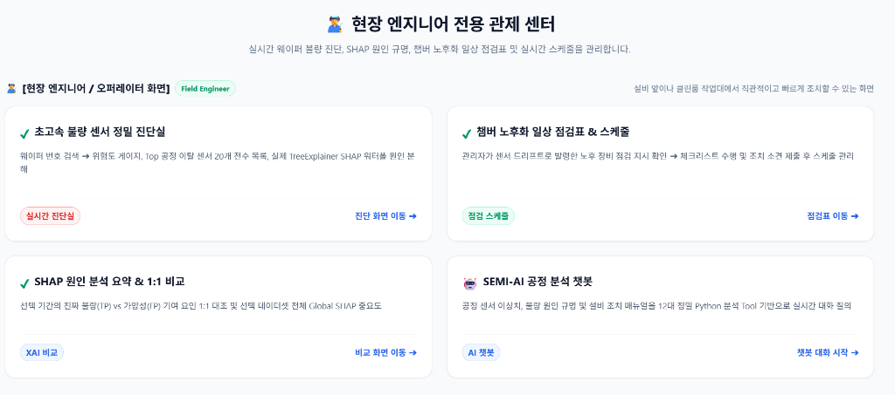

---

### 2.2 ⚡ 초고속 불량 센서 정밀 진단실 (Wafer Triage)
> 의심 웨이퍼(예: #3295) 번호를 입력하면 즉시 **위험도 게이지(Risk Score)**, **TreeExplainer 기반 SHAP 인공지능 원인 분해 워터폴**, 그리고 **정상 기준선 대비 5대 공정 이탈 센서 목록 및 현장 조치 가이드**를 실시간으로 출력합니다.

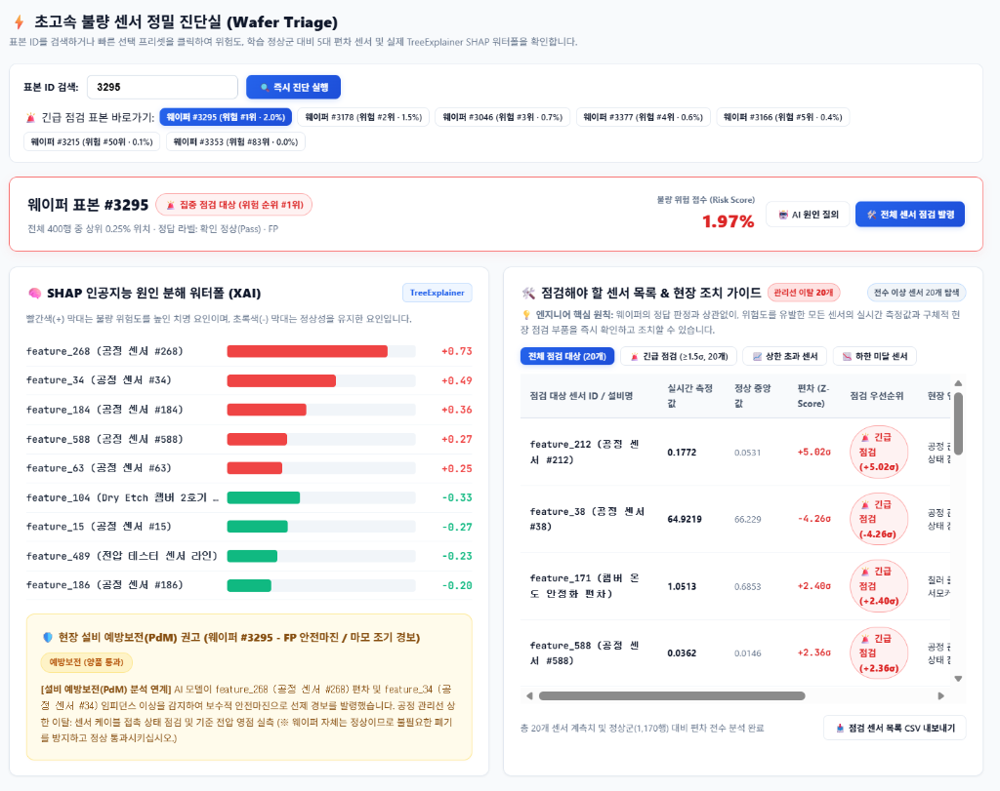

---

### 2.3 🧠 SHAP 원인 분석 요약: 진짜 불량(TP) vs 가양성(FP) 해명
> 단순한 예측에 그치지 않고, **실제 불량 웨이퍼(TP #3215)**와 모델이 보수적 안전마진으로 감지한 **정상 웨이퍼(FP #3295)**의 핵심 센서 기여도를 1:1로 맞대응하여 엔지니어에게 명확한 진단 근거를 제시합니다.

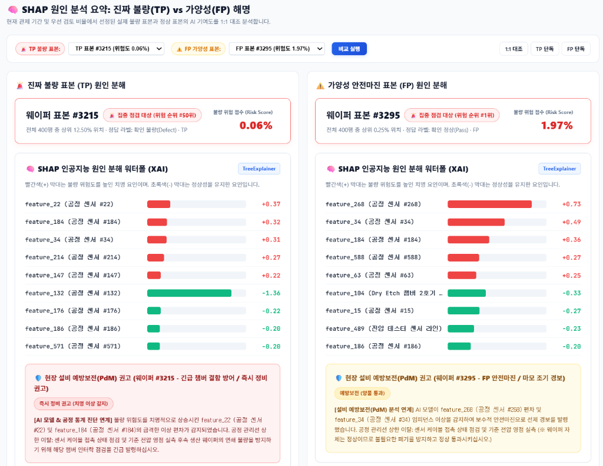

---

### 2.4 🎯 AI 모델 종합 성과 시뮬레이션 (검토 비율별 성과표 & 혼동행렬)
> 팹의 일일 계측 장비 한계를 고려하여, 검토 비율(5% ~ 50%) 조정에 따른 혼동행렬(Confusion Matrix), Recall(적발률), Precision(정밀도), Lift(검출 배수) 변화를 정량적으로 시뮬레이션합니다.

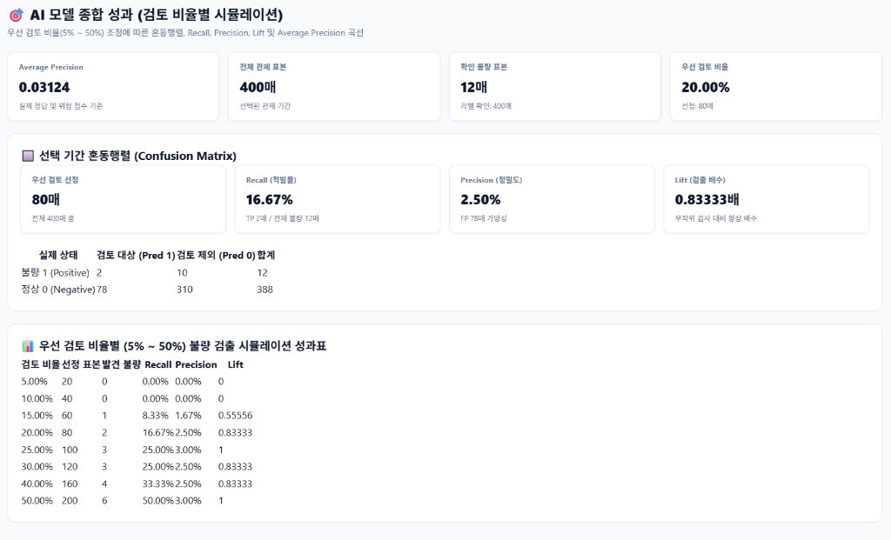

---

### 2.5 🛠️ 챔버 노후화 일상 점검표 & 4단계 실시간 PdM 스케줄
> 센서 드리프트 이상 징후 감지 시 자동으로 발령되는 4단계 스케줄 파이프라인(긴급 점검 발령 ➔ 현장 실사 및 점검 ➔ 관리자 승인 대기 ➔ 최종 승인 및 가동) 및 건식 식각(Dry Etch) 챔버 포커스링 마모 점검 체크리스트를 관리합니다.

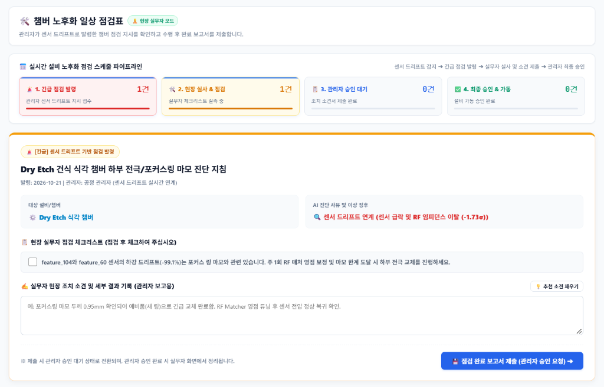

---

### 2.6 🤖 Gemini 3.8 Flash 자율 데이터 분석 챗봇 (SEMI-AI Agent)
> 정적 위키나 환각 위험이 있는 일반 챗봇을 탈피하여, 자연어 질문 시 **12종의 Python 분석 Tool을 직접 호출(Function Calling)**하여 실제 데이터 연산 결과(JSON)를 근거로 실시간 답변을 제공합니다. `[월별 불량률]`, `[검토 성능]`, `[드리프트 센서]` 추천 프리셋 및 자유 자연어 질의를 지원합니다.

<p align="center">
  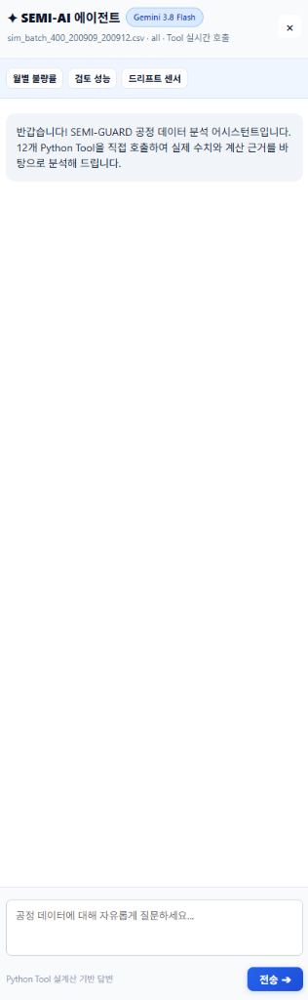
</p>

```json
// Gemini 3.8 Flash 실제 Tool 호출 및 수치 근거 반환 예시
{
  "tool_call": "diagnose_sample",
  "arguments": { "sample_id": "3295" },
  "execution_result": {
    "risk_score": 0.0197,
    "top_deviation_sensors": ["feature_212 (+5.02σ)", "feature_38 (-4.26σ)", "feature_171 (+2.40σ)"],
    "cumulative_shap": 0.73,
    "verdict": "FP 안전마진 경보 (임피던스 이상 감지, 불필요한 폐기 방지 권고)"
  }
}
```

---

## 📊 3. 모델링 및 단계별 비교 최적화 과정 (ML Engineering)

반도체 SECOM 데이터셋의 3대 난제를 극복하기 위해 수행한 체계적인 머신러닝 모델링 여정입니다.

```
[원천 1,567행 x 590열]
         │
         ▼ (1단계: 층화 8:2 분할 & Skewness 극복 Median 대치 & 3단계 노이즈 피처 정제)
[정제된 232개 피처]
         │
         ▼ (2단계: RobustScaler 표준화 & L1 LASSO 규제 ➔ 82.5% 노이즈 가중치 0화)
[최정예 78개 핵심 센서 풀]
         │
         ▼ (3단계: 20:1 비대칭 비용 손실함수 & abnormal_sensor_count 도메인 파생변수 생성)
[6종 모델 벤치마크] ──▶ 🏆 Enhanced LightGBM 챔피언 선정 (Recall@20% 71.4%, PR-AUC 0.2831)
```

---

### 3.1 모델링 데이터의 3대 핵심 난제 (EDA)

반도체 공정 데이터는 일반적인 머신러닝 데이터셋과 완전히 다른 3대 공학적 난제를 내포하고 있습니다.

| 핵심 난제 | 실측 현황 및 문제점 | 공학적 해결책 |
|---|---|---|
| **1. 극단적 클래스 불균형** | 정상 1,463장(93.36%) vs **불량 104장(6.64%)**<br>모두 정상으로 예측해도 정확도 93.4%가 나오는 **다수 범주 편향** 발생 | 층화 분할(Stratified Split) & 비용 민감 가중치 (`scale_pos_weight=5.0`) |
| **2. 590개 고차원 노이즈 & 결측** | 센서 40% 이상 왜도 2.0+ 및 특정 센서 결측률 60% 도달<br>극심한 다중공선성과 노이즈로 인한 과적합 위험 | 왜도 극복 **중앙값 대체(Median Imputation)** & 3단계 피처 정제 (590 ➔ 232개) |
| **3. 비대칭 오분류 손실 (20:1)** | 재검사 비용(FP=1) 대비 **불량 칩 유출 손실(FN=20)**이 20배 막대함 | 비대칭 손실 함수 수립 (`Cost = 1×FP + 20×FN`) & 최적 임계값 0.19 하향 |

| 그림 1. 극단적 클래스 불균형 (14:1) | 그림 2. 상위 20개 센서 결측치 분포 |
|:---:|:---:|
| 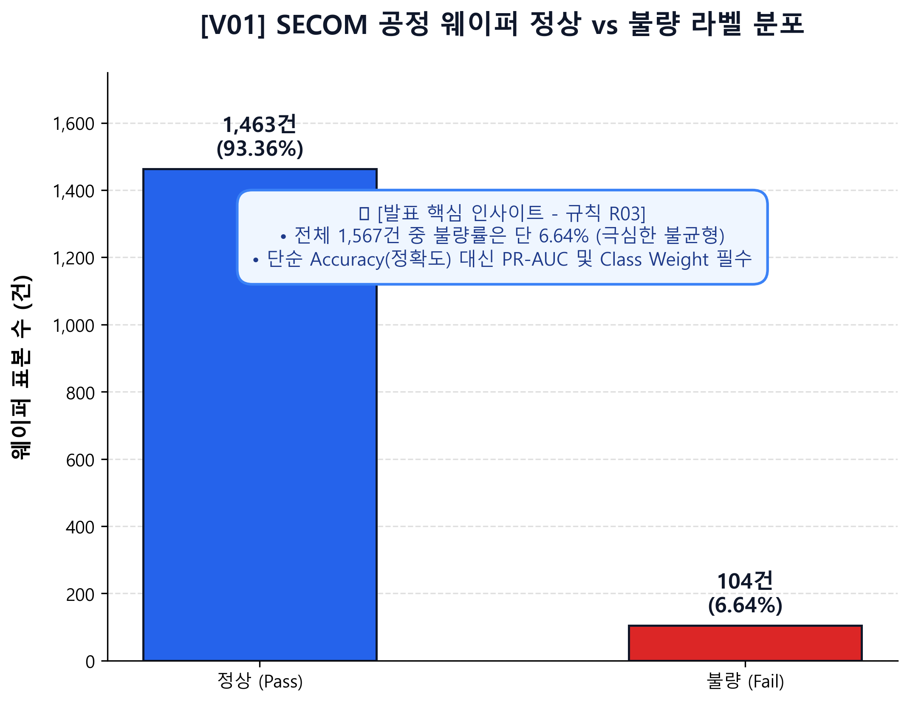 | 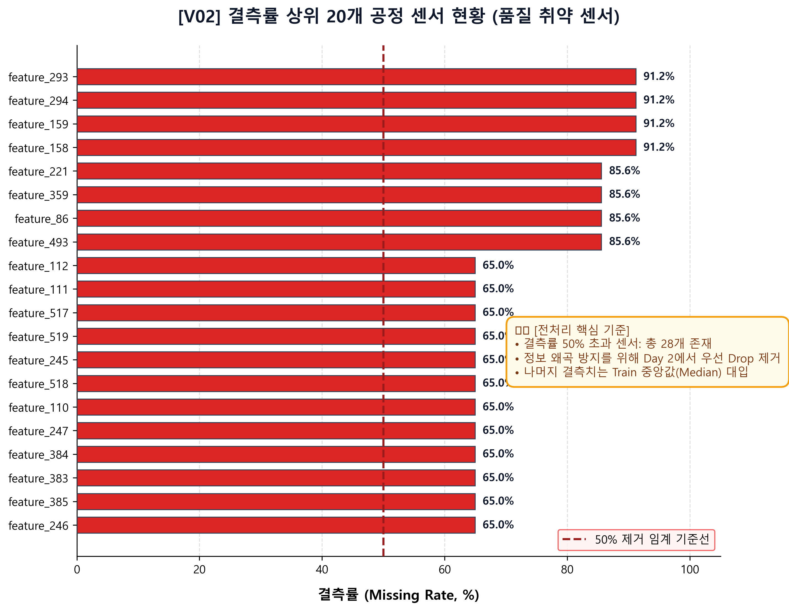 |

---

### 3.2 1단계: 데이터 정합성 검증 & 전처리 (590 ➔ 232개)

1. **층화 8:2 분할 (Stratified Split)**:
   - Train 1,253장 (불량 83) / Test 314장 (불량 21)으로 격리하여 6.64% 불량 비율을 엄격 보존.
2. **왜도(Skewness) 극복 중앙값 대치 (Median Imputation)**:
   - 센서의 40% 이상이 긴 꼬리를 갖는 왜도 2.0+ 분포를 보였습니다. 이상치에 취약한 평균(Mean) 대신 **중앙값(Median)**을 채택하여 통계 왜곡을 원천 차단했습니다.
3. **3단계 체계적 피처 정제 (Feature Pruning)**:
   - ① 결측률 50% 초과 센서 28개 제거
   - ② 분산이 0인 단일값(상수) 센서 116개 제거
   - ③ 상관계수 0.95 초과 다중공선성 센서 214개 제거
   - ➔ **총 358개 노이즈 피처를 소거하고 232개의 고품질 유효 센서 풀을 확정**.

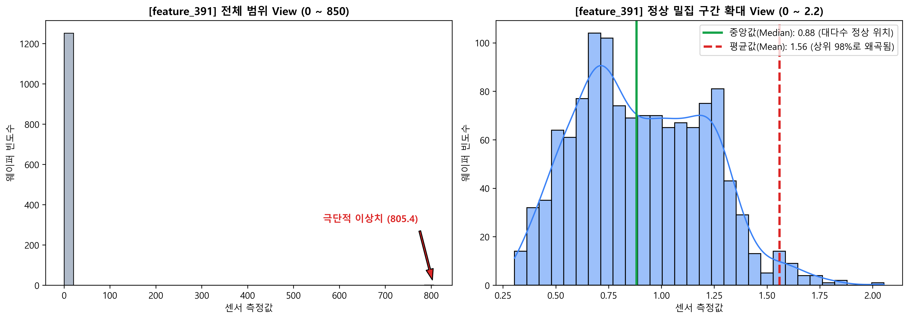

---

### 3.3 2단계: 4대 스케일러 벤치마크 & L1 LASSO 규제

스파이크 이상치가 빈번한 반도체 챔버 특성에 맞추어 4대 스케일러를 동일 조건에서 벤치마크했습니다.

| 스케일러 | 변환 방식 | Test 불량 재현율 (Recall) | 선정 결과 |
|---|---|:---:|:---:|
| **StandardScaler** | 평균 0, 분산 1 표준정규분포 | 19.0% | 탈락 (이상치에 의해 중심점 왜곡) |
| **MinMaxScaler** | 0~1 고정 범위 정규화 | 14.3% | 탈락 (극단적 이상치로 대다수 데이터 압축) |
| **QuantileTransformer** | 분위수 기반 균등 분포 변환 | 19.0% | 탈락 (비선형 왜곡 과다) |
| 🏆 **RobustScaler** | **중앙값 & 사분위수 범위(IQR)** | **23.8%** | **최종 채택 (이상치 저항성 최우수)** |

- **L1 LASSO Sparsity 효과**:
  - 잔여 232개 센서의 노이즈를 추가 제거하기 위해 L1 규제를 적용했습니다.
  - 불필요한 가중치를 정확히 `0.0`으로 수렴시켜 **유효 가중치 446개 중 82.5%(368개)를 완벽 소거**하고, **최정예 78개 핵심 센서**만으로 모델을 경량화했습니다.

---

### 3.4 3단계: 도메인 특화 파생변수 & 20:1 경제적 비용 행렬

1. **도메인 특화 파생변수 (`abnormal_sensor_count`)**:
   - 정상 웨이퍼 1,170장의 5~95 백분위수 관리 한계선(UCL/LCL)을 기준으로, **한계를 이탈한 이상 센서의 총합을 카운팅하는 파생변수**를 생성하여 다중 센서 복합 결함 신호를 강화했습니다.
2. **비대칭 비용 행렬 및 결정론적 컷오프**:
   - `Cost = 1×FP + 20×FN` 손실 구조를 수립하고, 분류 임계값을 기본 0.5에서 **0.19로 하향 조정**하여 불량 누락(FN)을 17개에서 6개로 65% 격감시켰습니다.
   - 팹의 일일 계측 장비 용량에 맞춰 Test 314장 중 **상위 20%(63장)**를 물리적 전수 검사 대상으로 선별하는 정책을 수립했습니다.

---

### 3.5 4단계: 6종 머신러닝 모델 벤치마크 및 챔피언 선정

동일한 평가 환경(Test 314장, 불량 21장)에서 6개 모델을 전수 벤치마크했습니다.

| 벤치마크 모델명 | 상위 20% 불량 포획 수 | Recall@20% | PR-AUC | 총 경제적 비용 | 평가 및 선정 사유 |
|---|:---:|:---:|:---:|:---:|---|
| **L1 Logistic Regression** | 12 / 21 | 57.1% | 0.1758 | 198 | 선형 기준 모델 (비선형 상호작용 한계) |
| **Random Forest Classifier** | 11 / 21 | 52.4% | 0.1642 | 214 | 트리 분할 깊이 한계로 탈락 |
| **LightGBM (기본 설정)** | 10 / 21 | 47.6% | 0.1580 | 231 | 클래스 불균형 미보정으로 탈락 |
| **LightGBM (`scale_pos_weight=5`)** | 13 / 21 | 61.9% | 0.2104 | 176 | 불균형 가중치로 성능 대폭 개선 |
| 🏆 **Enhanced LightGBM (+파생변수)** | **15 / 21** | **71.4%** | **0.2831** | **137** | **최종 챔피언 (포획률 71.4%, PR-AUC +61% 향상)** |
| **LambdaMART (`LightGBMRanker`)** | 9 / 21 | 42.9% | 0.1412 | 249 | 랭킹 쌍 희소성으로 그래디언트 붕괴 발생 |

> [!TIP]
> **🏆 Enhanced LightGBM 챔피언 승리 요인**:
> 1. 정상 한계선 이탈 센서 총합인 `abnormal_sensor_count` 파생변수가 복합 결함 신호를 강력하게 포착.
> 2. `scale_pos_weight=5.0` 설정을 통해 불량 클래스에 5배 가중치를 부여하여 다수 범주 편향 극복.
> 3. 기준 모델 대비 PR-AUC가 **0.1758에서 0.2831로 61% 수직 상승**하고 경제적 총손실 비용을 최저(137)로 절감.

---

### 3.6 5단계: 설비 예지보전(PdM) 드리프트 엔진 & Tri-Criteria 알고리즘

시계열 분석 결과, 평소 5~6%이던 불량률이 특정 기간에 15.8%까지 수직 폭증하는 비상사태가 발생했습니다. 원인 역추적 결과 CVD 증착 챔버의 전극 마모 및 히터 열화가 원인이었습니다.

사후 정비(Breakdown Maintenance)를 탈피하기 위해 **Tri-Criteria 센서 표류 감지 알고리즘**을 개발했습니다:
- **조건 1**: 시간 상관계수 `|r| >= 0.25`
- **조건 2**: Z-Score 표준화 편차 `|ΔZ| >= 1.0σ`
- **조건 3**: 이상치 비율 증가 `ΔOutlier >= 5%p`

위 3가지 조건을 동시 충족할 때 조기 경보를 발령하여, **CVD 챔버 압력 상승 및 에처 RF 파워 하강 표류를 설비 고장 2~3주 전에 포획**합니다.

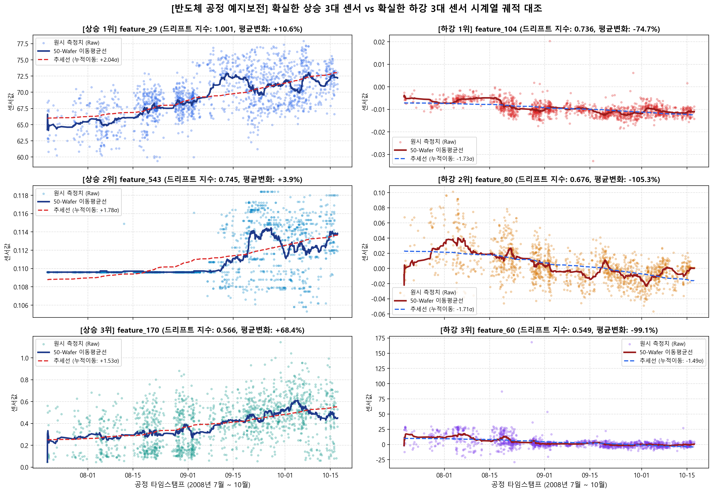

---

### 3.7 6단계: 글로벌 센서 중요도 (Global SHAP XAI)

TreeExplainer로 계산된 전체 데이터셋의 글로벌 SHAP 중요도를 통해, 공정 전체의 수율을 지배하는 Top 핵심 센서군을 규명했습니다.

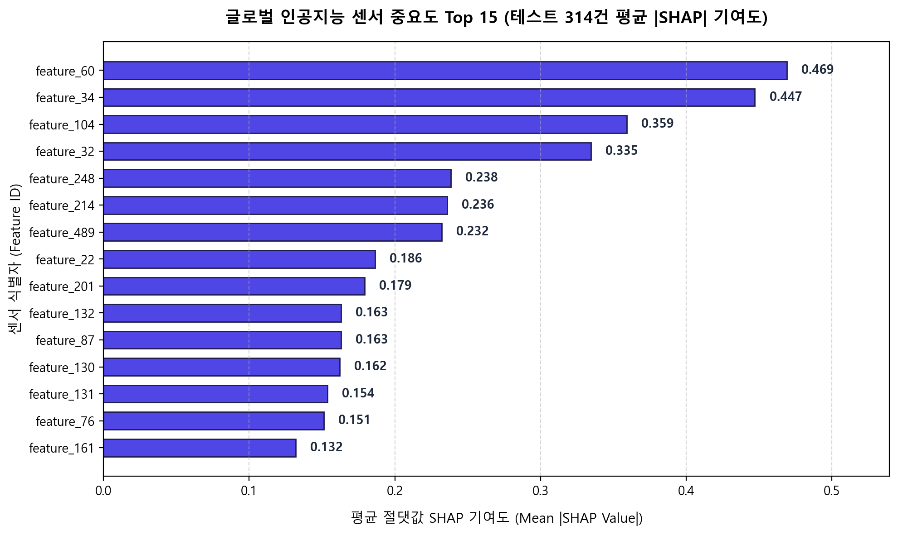

---

## 🏗️ 4. 시스템 아키텍처 & 워크플로우

### 4.1 서비스 아키텍처 (Service Architecture v3.0)
FastAPI 기반 비동기 백엔드와 Gemini 3.8 Flash 자율 분석 에이전트의 구조도입니다.

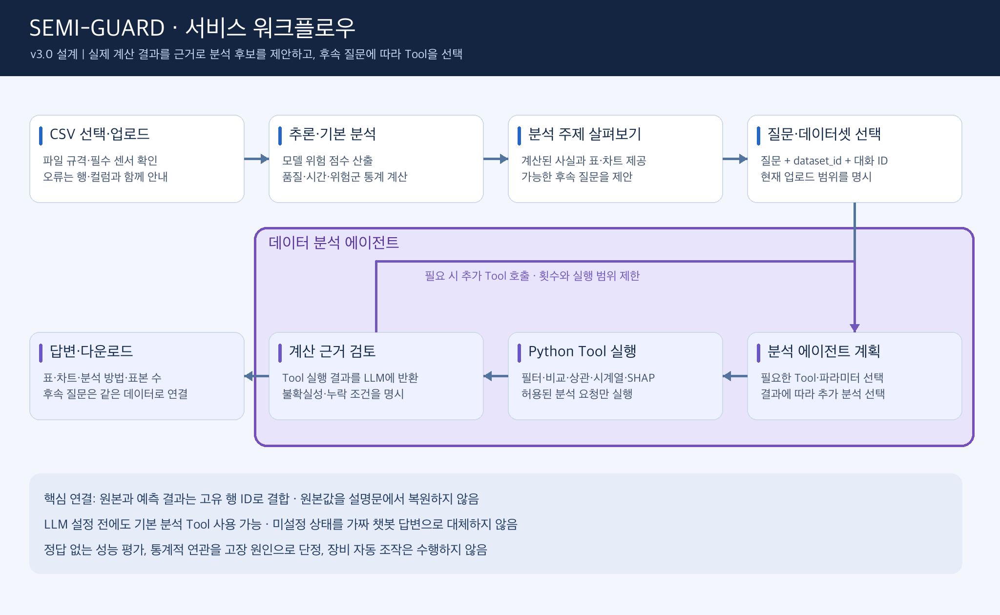

- **Presentation Layer**: HTML5 / Vanilla CSS / Modern JS 기반 고반응성 경량 웹 인터페이스.
- **Application Layer**: FastAPI 비동기 REST 라우팅 및 세션 쿠키 기반 브라우저 데이터셋 격리.
- **AI Agent Layer**: Gemini 3.8 Flash의 Function Calling을 활용한 최대 6회 반복 Tool 호출 루프.
- **Engine & Storage Layer**: 저장된 Enhanced LightGBM 모델 추론, SHAP TreeExplainer, SQLite/GCS 영속 저장소.

---

### 4.2 데이터 파이프라인 워크플로우 (Data Workflow v3.0)
데이터 유입부터 스키마 검증, 추론, XAI 연산 및 DB 저장 파이프라인입니다.

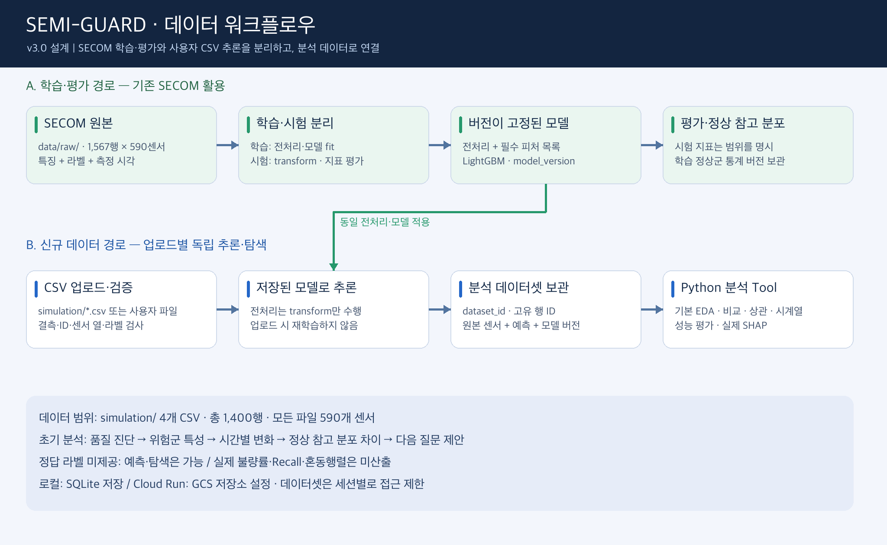

---

## 🛠️ 5. 12종 Python 데이터 분석 도구 (Analysis Tools)

Gemini 에이전트는 환각 없이 아래 12개 등록 도구를 호출하여 수치적 근거를 산출합니다.

| 도구명 (Tool) | 분석 내용 및 역할 | 주요 파라미터 / 입력 조건 |
|---|---|---|
| `profile_dataset` | 데이터셋 행/센서 수, 결측치·상수열 현황, 라벨 및 예측 위험도 분포 요약 | 데이터셋 전체 센서값 |
| `rank_samples` | 예측 위험 점수 상위/하위 N개 표본과 원본 센서값 조회 | `top_n`, `ascending` |
| `query_data` | 조건 필터링, 컬럼 선택, 정렬, 그룹 집계 (자유 질의) | `filters`, `columns`, `sort_by` |
| `compare_groups` | 고위험군(상위 20%)과 정상군의 센서 평균 및 표준화 차이(Z-Score) 비교 | `threshold_ratio` |
| `correlate` | 센서와 위험 점수 간 상관계수 또는 센서 간 상관계수 산출 | `target_col`, `top_n` |
| `time_summary` | 일별/주별/월별 표본 수, 평균 위험 점수, 확인 라벨 불량률 추이 | `freq` ('M', 'W', 'D'), timestamp 필요 |
| `compare_reference` | SECOM 학습 정상군(1,170행) 분포 대비 현재 배치의 센서 평균 이동량 및 KS 거리 | 버전 고정 정상 기준 분포 |
| `evaluate_predictions`| 검토 비율(Top 5%~50%)별 혼동행렬(TP/FP/FN/TN), Recall, Precision, Lift 평가 | 실제 정답 라벨 필요 |
| `explain_sample` | 특정 웨이퍼 표본의 SHAP 기여도, Base Value, 모델 예측 로그오즈 산출 | `sample_id` |
| `diagnose_sample` | 표본의 Top 5 센서 정상 구간(5~95%) 이탈 상태, 누적 SHAP, 진단 권고안 도출 | `sample_id` |
| `sensor_drift` | 시간 경과에 따른 센서값의 Pearson/Kendall 기울기, 상승/하강 추세 식별 | `direction` ('up', 'down', 'all') |
| `global_shap` | 데이터셋 전체의 평균 절대 SHAP 중요도 및 상위 영향도 센서 랭킹 도출 | `max_samples` (기본 200) |

---

## 🚀 6. 빠른 시작 (Quick Start)

### 6.1 환경 요구사항
- **Python 3.11** (scikit-learn 1.7.2 의존성 고정)
- Windows / macOS / Linux 지원

### 6.2 로컬 설치 및 서버 실행

```bash
# 1. 저장소 이동
cd SEMI-GUARD_updated_20261020

# 2. 가상환경 생성 및 활성화
# [Linux / macOS]
python3.11 -m venv .venv
source .venv/bin/activate

# [Windows PowerShell]
python -m venv .venv
.venv\Scripts\Activate.ps1

# 3. 필수 의존성 설치
pip install -r requirements.txt

# 4. FastAPI 서버 기동
uvicorn server.app:app --host 127.0.0.1 --port 8080
```

> [!TIP]
> **macOS 사용자 안내**: LightGBM 실행 시 `libomp.dylib` 오류가 발생하면 Homebrew로 설치하세요:
> `brew install libomp`

---

### 6.3 Gemini AI 에이전트 활성화 (선택)
기본 분석, SHAP, 드리프트, 표본 진단은 **API 키 없이 100% 동작**합니다.  
자연어 질의 기능을 사용하려면 환경변수에 Gemini API 키를 설정합니다.

```bash
# Linux / macOS
export GEMINI_API_KEY="your-gemini-api-key"
export GEMINI_MODEL="gemini-3.8-flash"

# Windows PowerShell
$env:GEMINI_API_KEY="your-gemini-api-key"
$env:GEMINI_MODEL="gemini-3.8-flash"

uvicorn server.app:app --host 127.0.0.1 --port 8080
```

---

### 6.4 Docker 컨테이너 실행

```bash
docker build -t semiguard:v3 .
mkdir -p runtime
docker run --rm -p 8080:8080 -v "$PWD/runtime:/app/runtime" semiguard:v3
```

---

## 🧪 7. 4대 시뮬레이션 배치(1,400행) 실측 검증 현황

본 시스템은 4개 시뮬레이션 검증 배치 CSV(총 1,400행)에 대한 전수 추론을 완료했습니다.

| 배치 파일명 | 기간 | 행 수 | 결측 셀 수 | 실제 불량률 | 상위 20% 검토 Recall |
|---|:---:|:---:|:---:|:---:|:---:|
| `secom_test_batch_200811_200903.csv` | 2008.11 ~ 2009.03 | 500행 | 13,253개 | 6.20% (31건) | **35.48%** |
| `sim_batch_200_200904_200905.csv` | 2009.04 ~ 2009.05 | 200행 | 5,280개 | 4.50% (9건) | **22.22%** |
| `sim_batch_300_200906_200908.csv` | 2009.06 ~ 2009.08 | 300행 | 8,064개 | 7.33% (22건) | **22.73%** |
| `sim_batch_400_200909_200912.csv` | 2009.09 ~ 2009.12 | 400행 | 10,367개 | 3.00% (12건) | **16.67%** |

- **단일 웨이퍼 정밀 분석 CLI**:
  ```bash
  python tools/analyze_wafer.py --sample-id 2184 --include-drift --include-global-shap --output artifacts/analysis_reports/detail_2184.json
  ```
- **자동화 단위/통합 테스트 (48개 PASS)**:
  ```bash
  pip install -r requirements-dev.txt
  python -m pytest -q tests
  ```

---

## 🔌 8. REST API 엔드포인트 명세

| Method | Endpoint | 설명 |
|---|---|---|
| `GET` | `/api/health` | 시스템 상태, 모델 로드 상태, 등록된 12종 Tool 목록 반환 |
| `POST`| `/api/predict-batch` | CSV 업로드 → 스키마 검증 → 모델 추론 → 기본 EDA 리포트 반환 |
| `GET` | `/api/simulation` | 서버 내 시뮬레이션 배치 CSV 목록 조회 |
| `POST`| `/api/simulation/{filename}/analyze` | 시뮬레이션 파일 즉시 추론 및 분석 |
| `GET` | `/api/datasets` | 현재 세션에서 분석된 데이터셋 목록 조회 |
| `GET` | `/api/datasets/{id}?offset=0&limit=50` | 데이터셋 페이징 조회 (원본 센서 + 모델 예측 결합) |
| `GET` | `/api/datasets/{id}/report` | 기본 EDA 종합 리포트 및 질의 추천 목록 조회 |
| `GET` | `/api/datasets/{id}/export` | 원본 센서값 + 예측 불량 확률 결합 CSV 다운로드 |
| `POST`| `/api/datasets/{id}/tools/{name}` | 특정 분석 Tool 직접 실행 (`arguments` 전달) |
| `POST`| `/api/chat` | Gemini 3.8 Flash 에이전트 질의 (`query`, `dataset_id`) |
| `GET` | `/api/evaluation` | 보관된 SECOM 테스트 데이터셋(314행) 모델 평가 지표 반환 |

---

## 📂 9. 프로젝트 디렉터리 구조

```text
SEMI-GUARD_updated_20261020/
├── artifacts/             # 저장된 LightGBM 모델, 전처리 파이프라인, 분석 보고서
├── data/raw/              # SECOM 원본 학습 데이터 (secom.data, secom_labels.data)
├── docs/                  # 기획서, PRD, 워크플로우 다이어그램, 최신 스크린샷
│   ├── assets/            # 아키텍처 및 워크플로우 이미지 (service/data_workflow_v3.png)
│   └── demo/              # 최신 고해상도 실시간 서비스 캡처 (01~05_live_*.png)
├── picture/               # EDA 통계 차트, 왜도 비교, SHAP 중요도, 센서 드리프트 그래프
├── runtime/               # 로컬 세션 SQLite 데이터베이스 보관 디렉터리
├── server/
│   └── app.py             # FastAPI 메인 웹 서버 & REST API 라우터
├── simulation/            # 4개 시뮬레이션 배치 검증 CSV (1,400행)
├── src/data_analysis/     # 핵심 분석 엔진 (validation, inference, repository, tools, agent, service)
├── tests/                 # 단위 및 통합 테스트 (48개 자동 검증 100% 통과)
├── tools/                 # 배치 분석 및 웨이퍼 상세 분석 CLI 스크립트
├── web/                   # 분석 UI 및 공정 관제 대시보드 정적 에셋 (index.html, style.css, app.js)
├── Dockerfile             # 컨테이너 빌드 명세
├── requirements.txt       # 의존성 패키지 명세
└── README.md              # 프로젝트 안내 문서 (본 문서)
```

---

## 📚 10. 관련 문서 및 참고 자료

- 🌐 [SEMI-GUARD 실시간 배포 웹 서비스](https://semiguard-app-ahftuulaqq-uc.a.run.app/)
- 📄 [서비스 상세 기획서 (최종)](docs/SEMI_GUARD_반도체_공정_AI_통합관제_최종_기획서.md)
- 📊 [SECOM 반도체 공정 불량검출 모델링 선정과정 리포트](docs/SECOM_반도체_공정_불량검출_모델링_선정과정_리포트.html)
- 📝 [SEMI-GUARD 최종 발표자료 슬라이드](docs/SEMI_GUARD_발표자료_슬라이드.html)
- 🎤 [SEMI-GUARD 발표 대본 및 진행 가이드](docs/SEMI_GUARD_발표_대본_및_진행가이드.md)
- 🔍 [상세 분석 계산 기준 및 소스 대조 기록](docs/detail_analysis_changes.md)
